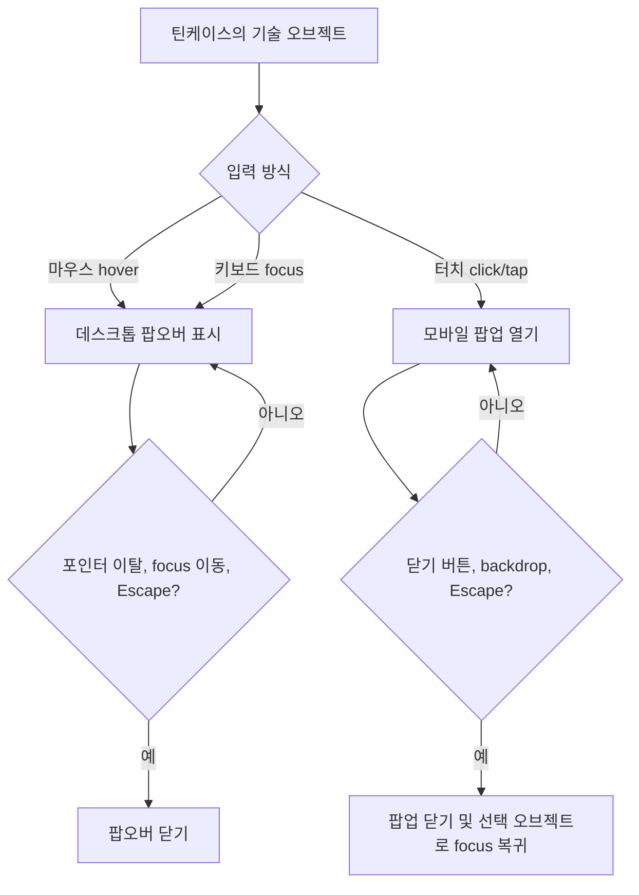

# TechMarquee 재설계 제안

> **상태:** 이 제안은 `src/components/main/TechMarquee.tsx`, `TechMarquee.module.css`, `Intro.tsx`에 반영되었습니다. 아래 구현 기록은 실제 반영 결과를 함께 설명합니다.

## 요약

구현 전 TechMarquee는 12개 기술 로고를 3D 원형 궤도로 계속 회전시키는 장식용 배경이었습니다. 실제 기술 설명은 별도의 `Technical Expertise` 카드에 있고, TechMarquee 자체는 모바일에서 숨겨지며 hover·click 상태가 없습니다. 제안은 이 회전 궤도를 **열린 라일락 틴케이스 속 물건을 탐색하는 인터랙티브 스택 보드**로 바꾸고, 기존 기술 그룹과 설명을 물건별 팝오버/모바일 팝업에 배치하는 것입니다.

## 구현 전 구조와 제약

### 실제 파일 위치

첨부 지시의 `@components/TechMarquee`, `@assets/styles`, `@assets/scripts` 경로는 저장소에 없습니다. 실제 구현은 아래 경로에 있습니다. `tsconfig.json`은 `@/*`를 `./src/*`에 연결하므로 실제 import 별칭은 `@/components/...` 형태입니다.

| 파일 | 구현 전 역할 |
|---|---|
| `src/components/main/TechMarquee.tsx` | `TechMarquee()`가 12개 로고 배열을 만들고 각도를 `360 / total`, 반지름을 `720px`로 계산해 궤도에 배치합니다. JSX의 `logos.map()`은 이미지에 alt를 제공하지만 상호작용 가능한 요소를 만들지는 않습니다. |
| `src/components/main/TechMarquee.module.css` | `.container` 높이는 `400px`, 원근은 `1200px`; `.orbit`은 `rotateOrbit` 키프레임을 25초 동안 무한 회전합니다. 개별 `.item`은 `80 × 60px`입니다. |
| `src/components/main/Intro.tsx` | `values` 4개와 `skills` 4개 그룹을 선언합니다. TechMarquee는 `md:flex`인 절대 배치 배경에 들어가며, 낮은 opacity와 blur/mask 레이어 뒤에 놓입니다. 모바일에서는 숨겨집니다. 실제 기술 설명은 별도의 `Technical Expertise` 카드와 보조 스택 칩에 있습니다. |
| `src/components/main/Home.tsx` | 메인 순서는 `Hero → Intro → FeaturedProjectList → Timeline`입니다. TechMarquee는 독립 페이지 섹션이 아니라 Intro 안에서 사용됩니다. |

현재 로고 배열은 HTML, CSS, JavaScript, TypeScript, React, jQuery, Tailwind, MUI, Bootstrap, Figma, Photoshop, Illustrator입니다. Intro의 상세 그룹에는 React, Next.js, TypeScript, JavaScript; Tailwind CSS, SCSS, Storybook, Figma; Supabase, Vercel; Git, GitHub, Jira, Notion이 있습니다. 보조 스택으로 MUI, Bootstrap, Redux, Recoil, Photoshop이 표시됩니다. 따라서 재설계 시 **로고 배열과 상세 기술 데이터가 서로 다른 두 목록이라는 점**을 먼저 정리해야 합니다.

### 확인된 제약

- `TechMarquee`의 `400px` 높이는 고정이며, orbit 반지름은 `720px`입니다. 정적인 작은 stage를 중심으로 로고가 회전하는 구조라 정보 읽기와 개별 선택을 위한 공간이 아닙니다.
- Intro에서 배경 장식으로 사용되기 때문에 위에 놓인 내용이 우선되고, 로고를 선택할 수 없습니다.
- `Intro.tsx`에서 `hidden md:flex`로 처리되어 작은 화면에서는 기술 마퀴가 완전히 사라집니다.
- 현재 CSS/TSX에는 hover 설명, 모바일 클릭 팝업, 포커스 상태, 닫기 동작이 없습니다.
- `assets/styles` 및 `assets/scripts` 폴더는 확인되지 않았습니다. 이 기능에 직접 연결되는 스타일은 `TechMarquee.module.css`, 동작과 데이터는 React 컴포넌트인 `TechMarquee.tsx` 및 `Intro.tsx`에 있습니다.

## 디자인 참고

### [Jackie Hu — Product Designer](https://jackiehu.design/?ref=killerportfolio)

확인한 화면은 따뜻한 아이보리 바탕, 넓은 여백과 중앙 타이포그래피를 사용하고, 노트·램프·펜·레코드·작은 알림 같은 오브젝트를 화면 가장자리에 비대칭 콜라주처럼 배치합니다. 플로팅 음악 플레이어와 알림, 도구 팔레트가 개인적인 작업 공간의 분위기를 만듭니다. 이 원칙은 틴케이스 주위의 여백, 겹쳐 놓은 카드와 작은 부가 UI의 밀도에 적용하되, OS 알림이나 Jackie Hu의 콘텐츠를 그대로 복제하지 않습니다.

### [Julia Moresco](https://juliamoresco.com.br)

이전 참고 화면의 접근성 구조에는 `0 OF 17 DISCOVERED`와 탐색 항목 목록이 노출되어, 물건을 발견하고 개별 정보를 여는 포트폴리오 패턴을 확인할 수 있었습니다. 캡처 당시 3D 장면은 로딩 문구를 표시해 세부 hover 상태를 끝까지 확인하지 못했습니다. 따라서 여기서는 **탐색 가능한 오브젝트라는 개념**만 참고하고, 구현 명세는 접근 가능한 명시적 버튼과 팝오버/팝업으로 구체화합니다.

### 첨부된 틴케이스 이미지

첨부 이미지는 따뜻한 린넨 위에 열린 라일락색 직사각형 케이스를 놓고, 뚜껑·사진·작은 소품·메모를 겹쳐 담은 구도입니다. 작은 카드에 종교 문구가 있으므로 화면 구현에서는 그 문구를 재현하지 않고, 해당 자리는 빈 카드나 중립적인 포트폴리오 라벨로 가립니다. 참고 원본은 [사용자 제공 이미지 URL](https://hebbkx1anhila5yf.public.blob.vercel-storage.com/560B9D76-7C0A-42FA-8A07-0A6F4969B6F2.PNG-s08QVRgObgR7SHp8HF1vuehVaHudYC.png)입니다.

## 제안하는 구조

### 1. Intro 안에서 기술 카드의 역할을 틴케이스로 전환

- Intro의 왼쪽 `values` 4개는 유지합니다.
- 오른쪽 `Technical Expertise` 카드는 열린 틴케이스 탐색 영역으로 대체합니다. 기존 상세 설명은 삭제하지 않고, 각 기술 그룹의 팝오버/팝업으로 이동합니다.
- 기술 설명을 `Intro.tsx`와 `TechMarquee.tsx`에 중복 선언하지 않도록, 구현 단계에서는 그룹 데이터를 한 곳에서 관리하고 TechMarquee에 전달하는 구조를 우선 검토합니다.
- 뚜껑에는 종교 문구가 아닌 `Design / Build / Collaborate`처럼 중립적인 라벨을 둡니다. 내부에는 기존 로고와 기술 그룹을 작은 카드, 스티커, 도구 또는 사진 프레임의 형태로 배치합니다.

### 2. 넓이와 반응형 레이아웃

기존 CSS 높이 `400px`의 120–150%는 `480–600px`입니다.

| 뷰포트 | 제안 크기 | 배치 |
|---|---:|---|
| 데스크톱 | 높이 약 `520–600px` | Intro의 오른쪽 주요 패널로 사용. 케이스와 hotspot이 잘리지 않도록 stage 전체에 여백 확보 |
| 모바일 | 높이 약 `480–520px` | 기술 케이스를 세로로 쌓거나 내부 콘텐츠를 재배치. TechMarquee를 숨기지 않고 터치 가능한 영역을 충분히 유지 |

좁은 화면에서는 케이스를 화면 너비에 맞춰 축소하되 hotspot의 터치 영역은 최소 `44 × 44px`로 유지합니다. 위치가 겹치는 경우 기술 항목을 줄이지 말고, 케이스 아래에 간단한 그룹 목록을 보조로 제공하는 방식을 권장합니다.

### 3. 기술 그룹과 내용 매핑

| 케이스 속 오브젝트 | 제목 | 기존 설명 및 연결할 기술 |
|---|---|---|
| 키캡/미니 기기 | Frontend | React, Next.js, TypeScript, JavaScript. “React와 Next.js 기반의 확장 가능한 프론트엔드 아키텍처 설계 및 구현” 설명을 유지합니다. HTML, CSS, jQuery 로고도 이 영역의 보조 요소로 배치할 수 있습니다. |
| 색상 카드/디자인 노트 | Styling & Design System | Tailwind CSS, SCSS, Storybook, Figma. “디자인 시스템 고도화, 컴포넌트화 및 UI 문서화” 설명을 유지합니다. MUI, Bootstrap, Photoshop, Illustrator는 보조 도구로 연결합니다. |
| 배포 카드/케이블 | Backend & Deployment | Supabase, Vercel. “백엔드 서비스 연동 및 효율적인 웹 배포 관리” 설명을 유지합니다. |
| 클립/체크리스트 | Collaboration & Workflow | Git, GitHub, Jira, Notion. “능동적인 일정 관리 및 협업 툴 활용” 설명을 ��지합니다. Redux와 Recoil은 현재 보조 스택 목록에 있으므로 보조 태그로 둘지 별도 그룹으로 분류할지는 구현 전에 확인합니다. |

## 상호작용 설계

### 데스크톱

- 각 오브젝트를 실제 `<button>`으로 만들고 마우스 hover와 키보드 focus에서 같은 팝오버를 표시합니다.
- 팝오버에는 그룹명, 기존 설명, 연결된 도구 목록을 포함합니다. 팝오버가 버튼 바로 옆에 놓이며 케이스의 `overflow: hidden`에 잘리지 않도록 별도 레이어 또는 적절한 positioning context를 사용합니다.
- 포인터가 버튼에서 팝오버로 이동하는 짧은 간격에도 팝오버가 닫히지 않도록 hover 경계를 함께 묶습니다. Escape, focus 이동, 포인터 이탈 시 닫힙니다.

### 모바일

- hover에 의존하지 않습니다. 오브젝트를 누르면 해당 설명을 팝업 또는 bottom sheet로 엽니다.
- 팝업에는 명확한 닫기 버튼, 제목, 설명, 도구 목록을 넣고 backdrop 탭과 Escape로 닫을 수 있도록 합니다. 닫은 뒤에는 원래 선택한 오브젝트로 포커스를 돌려보냅니다.
- 동작 상태는 화면 크기뿐 아니라 입력 방식도 고려합니다. 터치에서 hover 상태가 고착되지 않도록 별도 클릭 흐름을 둡니다.

## 접근성 및 시각 원칙

- 모든 오브젝트는 시각적으로만 선택 가능하게 두지 않고 버튼의 이름과 설명을 제공합니다. 열림 상태는 `aria-expanded`, 연결 콘텐츠는 `aria-controls` 또는 `aria-describedby`로 표현합니다.
- 키보드 focus 표시를 hover와 동등하게 제공하고, 색만으로 활성 상태를 구분하지 않습니다.
- 이미지가 단순 배경이면 빈 alt 또는 CSS 배경으로 처리하고, 의미 있는 오브젝트 사진이면 간결한 대체 텍스트를 제공합니다. 설명을 이미지에 구워 넣지 말고 실제 HTML 텍스트로 둡니다.
- 기존 25초 무한 회전은 탐색과 읽기를 방해할 수 있으므로 제거하거나 매우 약한 장식 모션으로 축소합니다. `prefers-reduced-motion`에서는 모션을 끕니다.
- 팔레트는 린넨 아이보리, 라일락, 진한 자주/회색 텍스트, 제한된 포인트 색으로 구성합니다. 본문과 hotspot의 대비를 먼저 확보하고, 사진 위 텍스트에는 단색 카드 바탕을 사용합니다.

## 구현 기록

| 대상 | 제안 |
|---|---|
| `src/components/main/TechMarquee.tsx` | 로고 궤도를 네 개 기술 그룹 hotspot으로 교체했습니다. 데스크톱은 hover/focus 팝오버, coarse pointer는 네이티브 dialog 팝업을 사용합니다. 기존 12개 로고와 `additionalSkills`도 유지합니다. |
| `src/components/main/TechMarquee.module.css` | 540px 데스크톱/480px 모바일 최소 높이의 틴케이스 stage, 텍스트 가림 라벨, 반응형 hotspot, 팝오버와 dialog 스타일을 정의합니다. 넓은 화면에서만 좌우 2단 배치를 사용합니다. |
| `src/components/main/Intro.tsx` | `values`를 유지하고 기술 상세 데이터를 `TechMarquee`에 전달합니다. 기존 배경 orbit, blur overlay, 평면 기술 카드는 제거했습니다. |
| `src/components/main/Home.tsx` | 메인 페이지에서 Intro의 순서는 변경하지 않았습니다. |
| 기술 그룹 데이터 | 별도 파일을 만들지 않고 `Intro.tsx`의 단일 `skills` 배열을 데이터 원본으로 유지합니다. |

## 가정 및 확인이 필요한 점

1. `Intro.tsx`의 네 기술 카테고리와 설명이 우선적인 콘텐츠 원본이며, 기존 12개 로고와 보조 스택은 가능한 한 그 분류에 맞춰 유지한다고 가정했습니다.
2. 첨부 이미지는 구도·색감 참고로 보고, 종교 문구가 있는 메모는 중립적인 카드로 가립니다. 종교 상징물 자체까지 제외할지는 요청에 명시되지 않아 이 제안의 범위에는 포함하지 않았습니다.
3. 제공된 이미지 Source URL을 장면 배경으로 사용하고, 종교 문구가 있는 메모 위에 불투명한 중립 라벨을 겹쳐 가립니다. 별도 이미지 파일을 저장하지 않았습니다.
4. Julia Moresco 캡처에서 확인한 세부 discovery 인터랙션은 제한적이므로, 본 제안은 탐색 가능한 오브젝트 패턴을 참고하되 hover/focus/touch 동작을 명시적으로 정의했습니다.
5. 설계 문서와 구현은 같은 Git 브랜치에서 관리됩니다. TechMarquee를 사용하는 다른 페이지가 추가되면 Intro의 그룹 데이터 공유 범위를 재검토해야 합니다.
